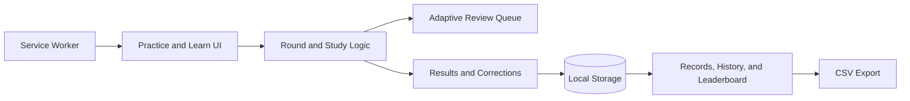

# Multiplication Practice

[](https://oscartron.github.io/multiplication-practice/)
[](LICENSE)
[](#technical-overview)

A responsive, local-first multiplication learning app designed for short, repeatable practice. It combines timed modes, focused review, adaptive repetition, flashcards, progress tracking, and offline support without accounts, advertising, or paid services.

**[Try the live application](https://oscartron.github.io/multiplication-practice/)**

## Project Overview

This project began as a focused tool to help children build multiplication fluency from 0 through 12. It evolved through direct family feedback, mobile testing, and child-usability reviews into a complete browser-based learning experience.

The product follows one central learning rule: **accuracy first, then speed**.

## Portfolio Highlights

- Built a complete responsive application with HTML, CSS, and vanilla JavaScript
- Designed an adaptive review queue that gives missed facts additional practice
- Implemented three timed difficulty modes with independent records
- Created device-local player profiles, progress history, and family leaderboards
- Added CSV data export without introducing a backend or external database
- Added installable and offline behavior with a web manifest and service worker
- Developed a consistent mobile design system for controls, typography, spacing, and feedback
- Iterated on the interface through real mobile and child-usability feedback

## Practice Rules

- Student contains 20 questions, Scholar contains 30, and Prodigy continues until time expires.
- Each question has three answer choices.
- Student offers 5, 10, 20, or 30-minute limits; Scholar and Prodigy last 2 minutes.
- Results and corrections appear only after the round.
- Missed facts return in later rounds for extra practice.
- The goal is 100% accuracy, followed by a faster personal-best time.

Student provides a relaxed accuracy-focused round. Scholar gives 30 questions in 2 minutes. Prodigy is a 2-minute speed round with no question limit.

## Features

- Vertical worksheet-style multiplication problems
- Three large answer choices
- Delayed results and correction review
- Adaptive repeat practice for missed facts
- Standard 0–10 and extended 0–12 number ranges
- Focused practice for any single multiplication table
- Three selectable practice levels with separate records
- Correct and incorrect visual feedback with optional sound effects
- Player profiles with separate practice records
- Device-local family leaderboard for perfect rounds
- Round-by-round progress table with CSV download
- Home navigation from completed rounds
- Interactive 0–10 or 0–12 multiplication chart
- Five-minute flashcards with one or multiple selected tables
- Device-local records and offline caching
- Responsive keyboard-accessible interface
- Original sci-fi interface typography using an offline system-font stack

## Technical Overview

| Area | Implementation |
| --- | --- |
| Front end | Semantic HTML, responsive CSS, vanilla JavaScript |
| State | Browser `localStorage` with validation and migration handling |
| Offline support | Service worker and web app manifest |
| Deployment | GitHub Pages |
| Data export | Client-generated CSV download |
| Dependencies | None at runtime |
| Privacy | No accounts, analytics, advertising, or remote data collection |

## Architecture



The application keeps UI rendering, learning logic, persistence, and offline caching separate while remaining small enough to run without a build system. See [Architecture Notes](docs/ARCHITECTURE.md) for details.

## Run locally

Clone the repository and start any static file server:

```bash
git clone https://github.com/OscarTron/multiplication-practice.git
cd multiplication-practice
python -m http.server 8000
```

Then open `http://localhost:8000`. The core interface also opens directly from `index.html`, but offline installation requires HTTP or HTTPS.

## Quality Approach

The project has been checked through complete practice-round testing, missed-fact review testing, double-click protection testing, responsive mobile and desktop reviews, a child-focused heuristic review, and JavaScript syntax checks.

Automated browser tests and broader cross-browser coverage are planned. Current verification details are documented in [Child Usability Review](CHILD_USABILITY_REVIEW.md) and the [Project Plan](PLAN.md).

## Privacy

Player names, scores, and practice history stay in the current browser. The family leaderboard and progress table are visible only on that device. The app does not send or collect personal information.

## Project Documentation

- [Architecture Notes](docs/ARCHITECTURE.md)
- [Project Plan](PLAN.md)
- [Changelog](CHANGELOG.md)
- [Child Usability Review](CHILD_USABILITY_REVIEW.md)
- [Design Rules](DESIGN_RULES.md)
- [Contributing Guide](CONTRIBUTING.md)

## Roadmap

- Lifetime accuracy by multiplication fact
- Practice streaks and achievement badges
- Parent-controlled data reset
- Automated browser tests
- Broader Chrome, Edge, Firefox, and Safari verification

## License

Released under the MIT License.
