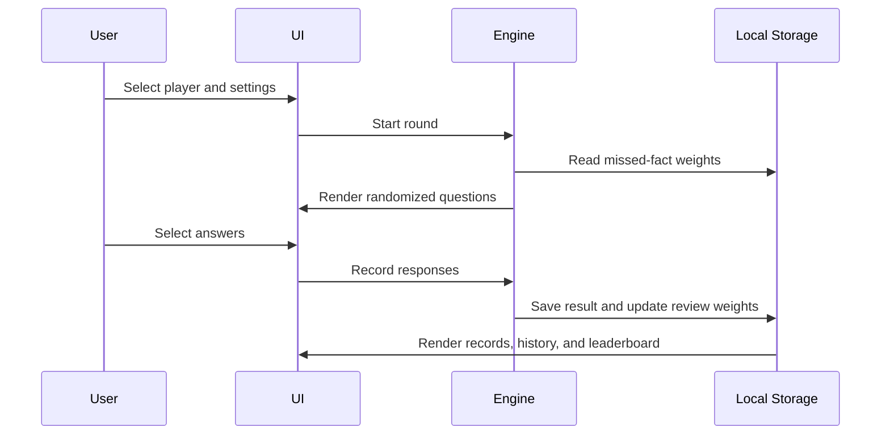

# Architecture Notes

## Goals

Multiplication Practice is intentionally small, local-first, and dependency-free. The architecture supports a complete learning workflow while keeping deployment simple enough for GitHub Pages.

## Runtime Structure

### Interface

`index.html` defines the practice, chart, flashcard, results, settings, and progress views. Existing element IDs form the interface contract used by the application logic.

`styles.css` owns the visual system, responsive breakpoints, control dimensions, feedback effects, and mobile layout. Desktop rules remain the baseline; mobile-specific adjustments are isolated inside media queries.

### Application Logic

`app-v8.js` owns:

- Player and settings validation
- Question and answer generation
- Timers and practice modes
- Adaptive missed-fact weighting
- Result calculation and correction review
- Chart and flashcard behavior
- Progress, leaderboard, and CSV rendering

The app generates all questions in the browser. It does not call remote services.

### Persistence

The application stores one versioned state object in browser `localStorage`. The state contains current settings, player records, bounded round history, missed-fact review weights, and the sound preference.

Boundary-cleaning functions validate saved values before the UI or practice engine consumes them. History is bounded to prevent unlimited storage growth.

### Adaptive Review

Incorrect facts receive additional review weight. Correct responses gradually reduce that weight. At the start of a round, the highest-priority missed facts are inserted before the remaining randomized question pool.

This provides lightweight spaced repetition without requiring an account, backend, or prediction service.

### Offline Support

`service-worker.js` caches the application shell. Cache names and asset query versions are advanced together when published so returning users receive new releases while retaining offline access.

`manifest.webmanifest` provides installable app metadata for supported browsers.

## Data Flow

## Design Constraints

- No runtime dependencies
- No account or backend requirement
- No remote analytics or advertising
- Mobile-first usability with desktop parity
- Accuracy prioritized before speed
- Results withheld until the round is complete
- Saved data remains visible and exportable to the user

## Known Limits

- Progress does not synchronize across devices
- Browser-data deletion removes local records unless a CSV was exported
- Automated browser coverage is not yet included
- Screen-reader and broad cross-browser audits remain roadmap items
